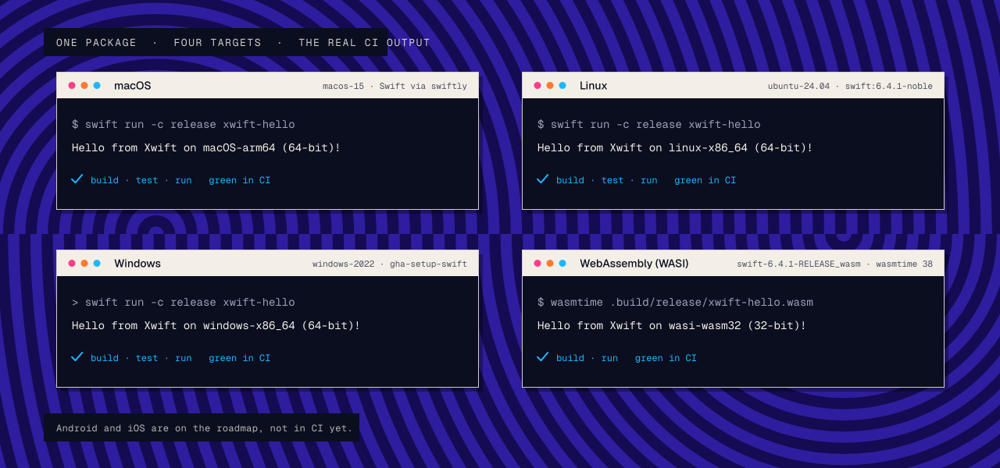

<h1 align="center">
  <picture>
    <source media="(prefers-color-scheme: dark)" srcset="assets/xwift-logo-dark-md.svg">
    <source media="(prefers-color-scheme: light)" srcset="assets/xwift-logo-light-md.svg">
    
  </picture>
</h1>

A cross-platform toolchain for the Swift language, built on upstream Swift and LLVM.

  <a href="https://xwift-web.vercel.app">Site</a> ·
  <a href="https://xwift-web.vercel.app/docs">Docs</a> ·
  <a href="https://xwift-web.vercel.app/blog">Blog</a> ·
  <a href="#repositories">Repositories</a> ·
  <a href="#targets">Targets</a>

  <picture>
    <source media="(prefers-color-scheme: dark)" srcset="assets/hero-dark.svg">
    <source media="(prefers-color-scheme: light)" srcset="assets/hero-light.svg">
    
  </picture>

Write once. Run everything. Today Xwift is a proof of concept: one SwiftPM package, stock Swift 6.4.1, four targets green in CI. Nothing is forked. Nothing is patched. The rest is on the roadmap, and it is labelled that way.

| One package | Four targets | Stock Swift |
| --- | --- | --- |
| `XwiftCore` and `xwift-hello`, tested with XCTest and swift-testing. | macOS, Linux, Windows and WebAssembly (WASI), each a CI job on every push to `main`. | Swift 6.4.1 from swift.org and the official Swift SDK for WebAssembly, pinned by version and checksum. |

## Targets

  

| Target | Status | CI does |
| --- | --- | --- |
| macOS · arm64 | ✅ working | build · test · run |
| Linux · x86_64 | ✅ working | build · test · run |
| Windows · x86_64 | ✅ working | build · test · run |
| WebAssembly (WASI) · wasm32 | ✅ working | build · run under wasmtime |
| Android | 🗺️ roadmap | not in CI yet |
| iOS | 🗺️ roadmap | not in CI yet |

## Repositories

| | Repository | What |
| --- | --- | --- |
| 1 | [`xwift`](https://github.com/xwift-org/xwift) | The proof of concept: SwiftPM package, tests, CI on four targets. |
| 2 | [`xwift-web`](https://github.com/xwift-org/xwift-web) | The site, docs and blog at [xwift-web.vercel.app](https://xwift-web.vercel.app). |

Both repositories are private for now. The site is public.

## Palette

  

## Questions

Is Xwift a new compiler?

No. It is built on upstream Swift and LLVM. The proof of concept uses the stock Swift 6.4.1 toolchains, unmodified.

Does it run on Android or iOS?

Not yet. Both are on the roadmap and neither is in CI, so neither is claimed.

Is Xwift affiliated with Apple?

No. Swift and the Swift logo are trademarks of Apple Inc.

---

  
    Xwift · Teodor Walter Vido · 2026 
    <a href="https://xwift-web.vercel.app">Site</a> ·
    <a href="https://xwift-web.vercel.app/docs">Docs</a> ·
    <a href="https://xwift-web.vercel.app/blog">Blog</a>
  

